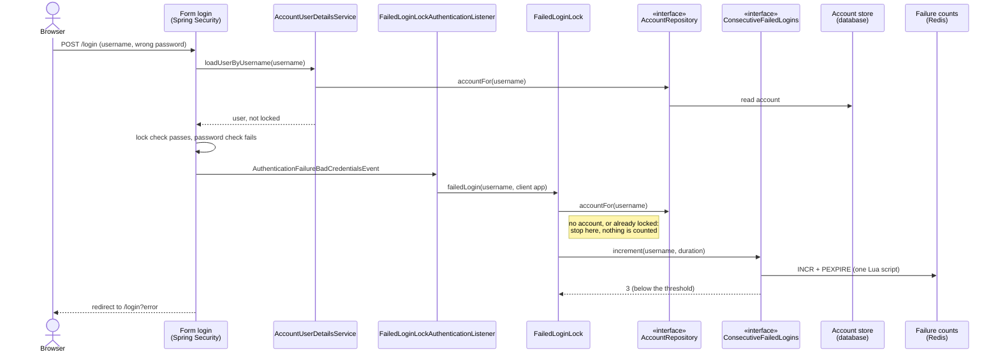
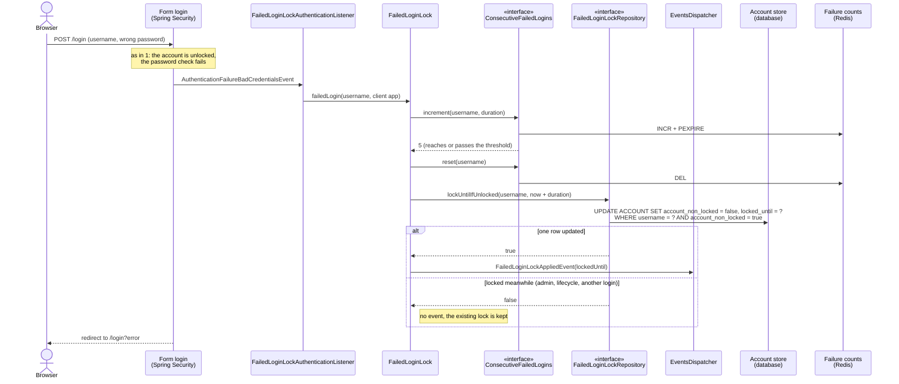
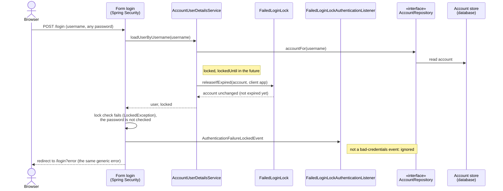
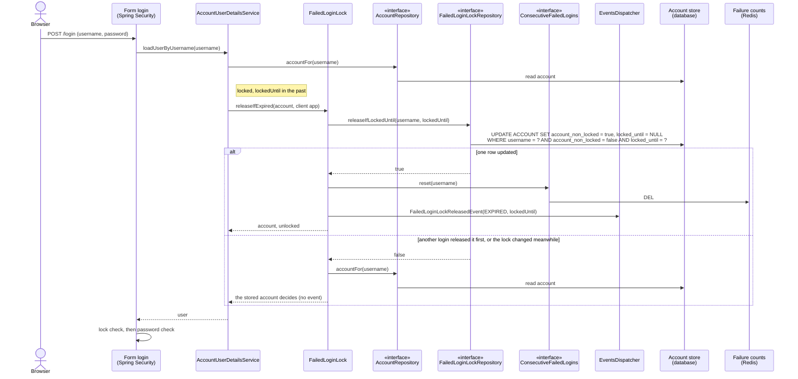
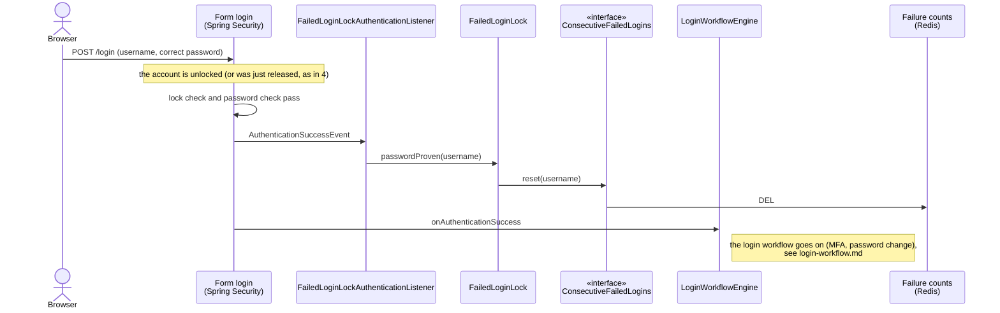
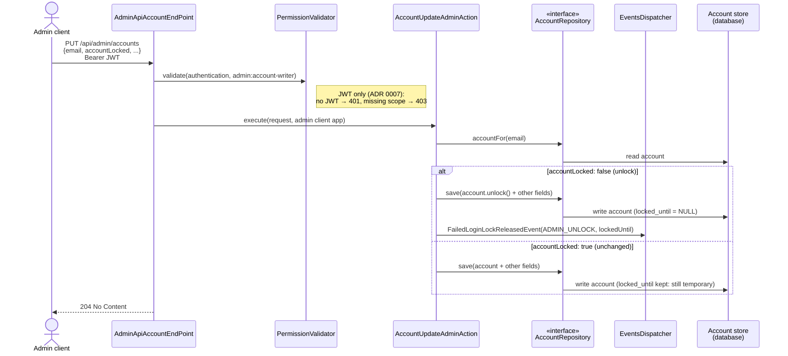

# Failed-Login Lock

## Abstract

When an account's **Consecutive Failed Logins** reach a configured threshold, VAuthenticator locks the account with a
**Failed-Login Lock**: an account lock that ends on its own once the configured duration has passed. The domain
vocabulary is defined in [CONTEXT.md](../CONTEXT.md), and the design decision in
[ADR 0011](adr/0011-failed-login-lock-reuses-account-lock.md).

The lock end is stored on the PostgreSQL `ACCOUNT` row. With the account cache enabled, applying and lifting the lock
evict the cached account ([ADR 0012](adr/0012-postgresql-only-persistence-with-evict-on-write-caches.md)).

### What counts

- Only wrong passwords on the login form count. A wrong MFA code or a failed password change does not.
- The count is per account (username) and consecutive: a successful login resets it, and so do applying or ending a
  lock and a period of one lock duration without a failure.
- Usernames with no account count for nothing.
- While the account is locked every login is refused, even with the right password, with the same generic login error
  as any failed login. Those attempts are not counted and do not extend the lock.

### How the lock ends

The lock reuses the account's locked flag, marked as temporary by a lock end (`lockedUntil`) stored on the account.
There is no scheduler: at the first login attempt after the lock end, the account is unlocked before the password is
checked. Only an account that is unlocked gets a Failed-Login Lock, so locks set by signup (email verification), by an
admin, or by the `ACCOUNT_LOCK` password lifecycle action never expire on their own. Applying and lifting the lock are
conditional updates on the `ACCOUNT` row, so applying a lock never overwrites an admin or lifecycle lock, and only one
of several logins after expiry releases the lock and publishes the release. Other account updates, such as an admin
save or a password reset or change, still save the whole account and the last write wins, so one that races a lock
being applied can erase it.

- **Admin save** (`PUT /api/admin/accounts`): only a change of `accountLocked` is an explicit lock or unlock. Saving
  `accountLocked: true` for an account under a Failed-Login Lock keeps it temporary; saving `false` ends it at once.
- **Password lifecycle**: the `ACCOUNT_LOCK` action firing on an account under a Failed-Login Lock makes the lock
  lasting.
- **Not affected**: sessions and tokens issued before the lock keep working; password reset neither lifts the lock nor
  is blocked by it.

`GET /api/admin/accounts/{email}/email` returns `lockedUntil` (an ISO-8601 instant, or `null` for a lasting lock or no
lock).

### Events

- `FailedLoginLockAppliedEvent`: payload (`FailedLoginLockApplied`) is the lock end. Published when the lock is
  applied.
- `FailedLoginLockReleasedEvent`: payload (`FailedLoginLockRelease`) is the reason (`EXPIRED` or `ADMIN_UNLOCK`) and
  the lock end. Published when the lock actually ends. An expired lock is released at the next login attempt, so the
  event time can be later than the lock end, and no event is published if nobody tries to log in again.

A login with no client app (a direct `/login`) attributes its events to the system client.

## Components

| Component | Role |
|---|---|
| `FailedLoginLockAuthenticationListener` | Listens to the Spring authentication events of the login form. Only the exact `AuthenticationFailureBadCredentialsEvent` is a failed login, and only the exact `AuthenticationSuccessEvent` proves the password: MFA and change-password publish subclasses of their own, which are ignored. |
| `FailedLoginLock` | The domain rules: count a failed login, apply the lock at the threshold, reset the count when the password is proven, release an expired lock. |
| `ConsecutiveFailedLogins` | Port for the failure count. `RedisConsecutiveFailedLogins` increments it and renews its expiry in one Lua script. |
| `FailedLoginLockRepository` | Port for applying and lifting the lock as conditional updates. `JdbcFailedLoginLockRepository` runs them as `UPDATE ... WHERE` statements on the `ACCOUNT` row. |
| `AccountUserDetailsService` | Loads the account for the login form and releases an expired lock before Spring checks the lock. |
| `AccountUpdateAdminAction` | The admin save: applies the lock rules for `accountLocked` and publishes `ADMIN_UNLOCK`. |

## Sequence diagrams

Every adapter appears only as the port it implements (`«interface»`). Stores are marked `(database)` and `(Redis)`. The
diagrams are Mermaid, so GitHub renders them in place. "Spring Security" stands for the form login filter, the
`ProviderManager` that publishes the authentication events, and the `DaoAuthenticationProvider` that loads the account,
checks the lock and then the password.

### 1. A wrong password below the threshold

The failure is counted; nothing else changes.



### 2. A wrong password reaches the threshold

The count is reset and the lock is applied only if the account is still unlocked.



### 3. A login while the lock lasts

Spring refuses a locked account before it checks the password, so the attempt is neither counted nor extends the lock.



### 4. The first login after the lock end

The lock is lifted before the password is checked; the login then goes on as usual (1, 2 or 5).



### 5. A correct password resets the count



### 6. An admin saves an account under a Failed-Login Lock

The admin always sends the whole account; only a change of `accountLocked` is an explicit lock or unlock.



Locking an unlocked account from the admin API (`accountLocked` changing to `true`) is a lasting lock (`lock()`, no
lock end). The `ACCOUNT_LOCK` password lifecycle action firing on an account under a Failed-Login Lock also makes the
lock lasting, by clearing its end.

## Configuration

```yaml
login:
  failed-login-lock:
    threshold: 5    # consecutive failed logins that lock the account; 0 turns the feature off
    duration: 1m    # how long the lock lasts, and how long an idle failure count is kept
```

Both have the defaults shown, so the feature is on without any configuration. With a threshold of `0` no new locks
are applied, but existing ones still expire.

The failure count is kept in Redis under the key `consecutive_failed_logins_<username>`.

## Upgrading

The `ACCOUNT` table has a new nullable column. There is no migration tool, so existing PostgreSQL databases need:

```sql
ALTER TABLE ACCOUNT ADD COLUMN locked_until TIMESTAMP WITH TIME ZONE;
```
