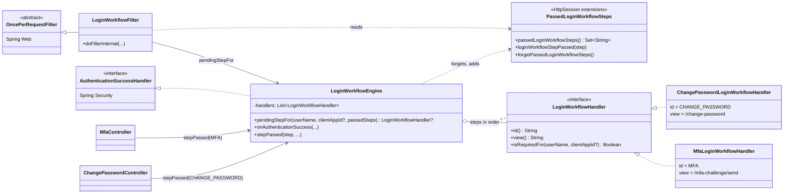
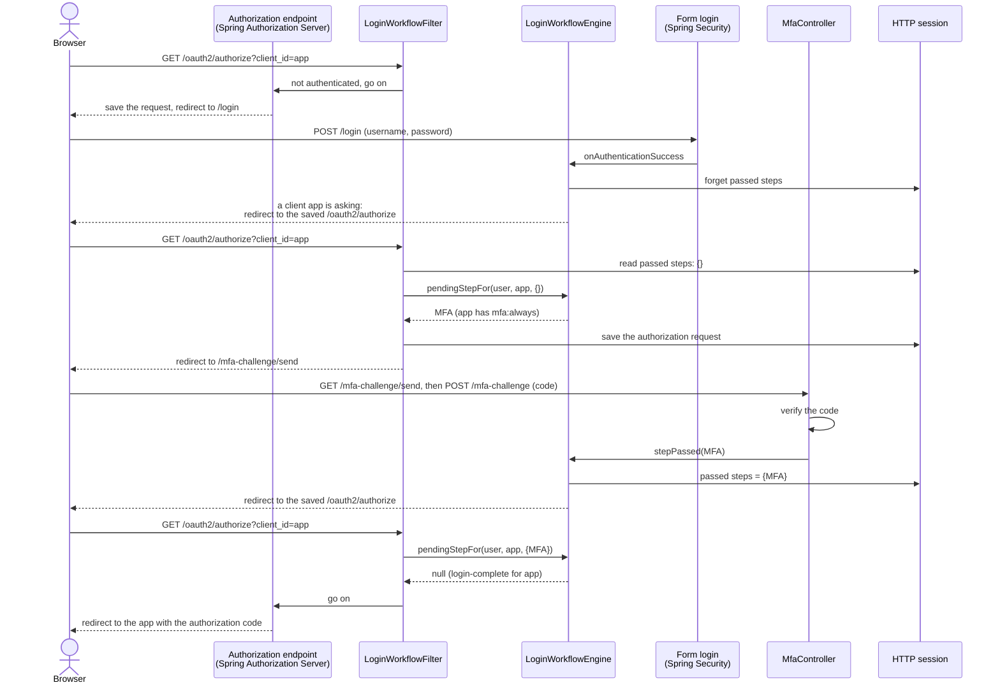
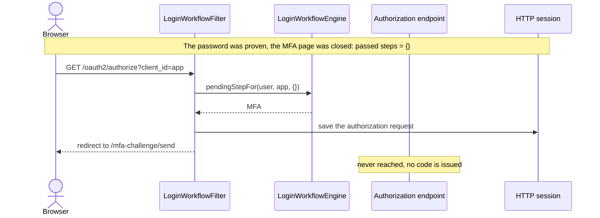
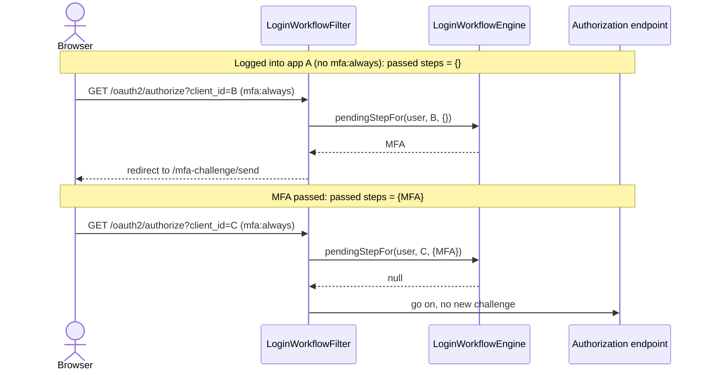
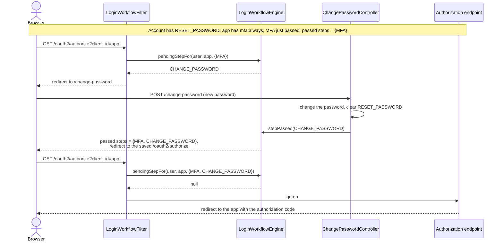
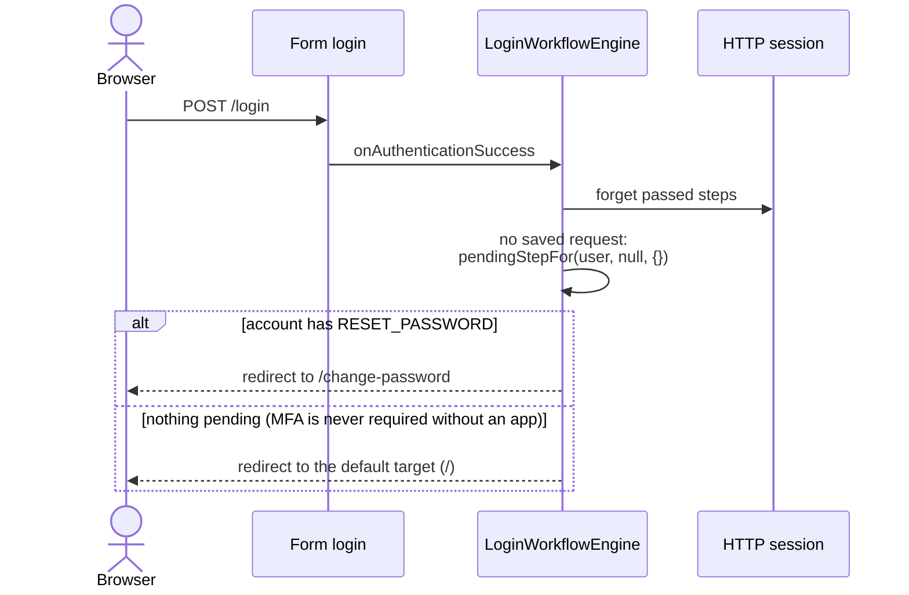

# Login workflow

After the account holder proves their password, the login workflow decides what else they must pass before a client app accepts the session. Today the steps are, in this order:

1. **MFA challenge**: required by client apps with the `mfa:always` scope. Such an app must also have `mfa:enrollment`, or the MFA page cannot list the account's devices (see [mfa.md](mfa.md)).
2. **Mandatory password change**: required while the account has the `RESET_PASSWORD` mandatory action.

The vocabulary (Login Workflow, Passed Step, Login-Complete, Second-Factor-Verified Session) is defined in [CONTEXT.md](../CONTEXT.md). The design decisions and the rejected alternatives are in [ADR 0010](adr/0010-login-workflow-checked-at-authorization-request.md). The MFA endpoints are described in [mfa.md](mfa.md).

The diagrams are Mermaid, so GitHub renders them in place.

The engine itself is kept deliberately small for now; its design is to be revisited in [#288](https://github.com/mrFlick72/vauthenticator/issues/288).

## Rules

- **The workflow is checked on every authorization request** (`/oauth2/authorize`), not only right after the password. That is the only point where a session becomes a login into a client app, so a session that left a step page, or that asks for a second app, is checked again.
- **A step is required or not on its own terms**: for this account and this client app. Nothing remembers a position in the workflow.
- **The session remembers each passed step.** A step the account holder actually completed is not presented again for the rest of the session, for any client app. A step that was skipped because it was not required is not passed, and is evaluated again next time.
- **The first required step that is not passed is the pending one**, in the fixed order above. MFA comes first, so a password alone cannot be used to change the password.
- **After a step is passed, the account holder goes back to the authorization request** that sent them there, which checks the workflow again. Steps never hand off to each other.
- **A new password login forgets the passed steps.** The workflow starts fresh, even for the same user signing in again in the same session.
- **A login with no client app asking** (the login page opened directly) runs the steps that do not depend on an app, such as the password change, straight away. The MFA step waits for the first app that requires it.
- **A passed step lasts until the session ends** (logout or expiry). Revoking an MFA device does not clear it.

## Components

| Component | Package | Role |
|---|---|---|
| `LoginWorkflowHandler` | `login.workflow` | A step: its `id`, its page (`view`) and `isRequiredFor(userName, clientAppId?)`. |
| `MfaLoginWorkflowHandler` | `mfa.domain` | The MFA step (`MFA`). Required when the client app has `mfa:always`; never when no app is asking. Page: `/mfa-challenge/send`. |
| `ChangePasswordLoginWorkflowHandler` | `password.domain.changepassword` | The password change step (`CHANGE_PASSWORD`). Required while the account has `RESET_PASSWORD`. Page: `/change-password`. |
| `LoginWorkflowEngine` | `login.workflow` | The ordered steps and `pendingStepFor(userName, clientAppId?, passedSteps)`: the first required step that is not passed, or `null`. Also the form login success handler, and `stepPassed`, which a step page calls once its step is passed: it records the step and resumes the authorization request. |
| `LoginWorkflowFilter` | `login.workflow` | Runs the workflow on every authorization request in the authorization server security chain. |
| `PassedLoginWorkflowSteps.kt` | `login.workflow` | `HttpSession` extensions that read, add and forget the passed steps. |

## Session state

The passed steps live in one session attribute, `PASSED_LOGIN_WORKFLOW_STEPS`: a `java.util.HashSet` of step ids (`MFA`, `CHANGE_PASSWORD`). Plain strings in a standard collection keep it serializable by Spring Session, so it is stored in Redis with the rest of the session.

The authorization request to resume is Spring Security's saved request (`HttpSessionRequestCache`, attribute `SPRING_SECURITY_SAVED_REQUEST`), the same one Spring saves when it sends an unauthenticated browser to `/login`. The filter saves it again before sending the account holder to a step, so the step page can always resume it, and the MFA page can always find the client app it is working for.

Sessions created before this workflow have no passed steps and are treated like any other session.

## Sequence diagrams

### 1. Log into an app that requires MFA

The normal path. The form login success handler only resets the workflow and resumes the authorization request; the filter runs it.

### 2. Leave the MFA page and come back

Closing the MFA page leaves the MFA step not passed. Reopening the app is a new authorization request, so the filter sends the account holder back to MFA instead of issuing a code.

### 3. A second app in the same session

Each app's requirements are checked against what the session has passed. Logging into an app without `mfa:always` does not count as MFA; once MFA is passed, it counts for every app that requires it.

### 4. MFA, then a mandatory password change

Both steps are pending. MFA comes first; each step page resumes the authorization request, and the filter picks the next pending step.

### 5. Login with no client app asking

The login page was opened directly, so there is no saved authorization request and the filter is not reached. The success handler runs the steps that do not depend on an app.

## Spring wiring

- `WebSecurityConfig` declares the steps (`mfaLoginWorkflowHandler`, `changePasswordLoginWorkflowHandler`), the engine (`loginWorkflowEngine`, used as the form login `successHandler` and injected into `MfaController` and `ChangePasswordController` together with their step), the request cache and redirect strategy, and the `AuthenticationTrustResolver`.
- `AuthorizationServerConfig` declares `loginWorkflowFilter` and adds it to `authorizationServerSecurityFilterChain` with `addFilterBefore(…, AbstractPreAuthenticatedProcessingFilter)`. The authorization endpoint filter is registered at the same position later, when the chain is built, so the login workflow filter runs first.
- `loginWorkflowFilterRegistration` is a disabled `FilterRegistrationBean`. Spring Boot registers every `Filter` bean as a servlet filter on all requests; this filter must run only inside the security chain, where the security context is loaded.
- The filter matches the authorization endpoint configured in `AuthorizationServerSettings`.

## Adding a step

1. Implement `LoginWorkflowHandler` in the domain package that owns the step: a stable `id`, the page, and `isRequiredFor`. Return `false` when the step depends on the client app and `clientAppId` is `null`.
2. Declare it as a bean and add it to the list in `loginWorkflowEngine`, at the position it must be presented in.
3. From the step page, once the step is passed, call `LoginWorkflowEngine.stepPassed` with the step.
4. Make the step page reachable by an authenticated session that is not login-complete (`WebSecurityConfig`), and keep anything it calls from accepting a session for more than the step needs.
5. Add the step to the list at the top of this page and to [CONTEXT.md](../CONTEXT.md).

A step whose requirement changes while it is passed (for example an admin forcing a new password reset mid-session) is not presented again until the next session or the next password login.
