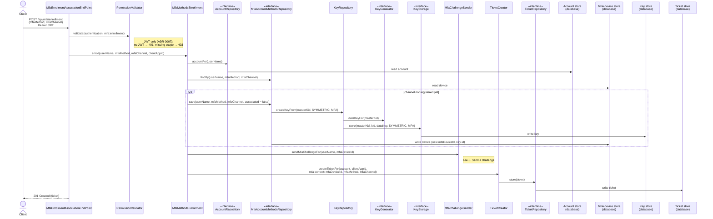
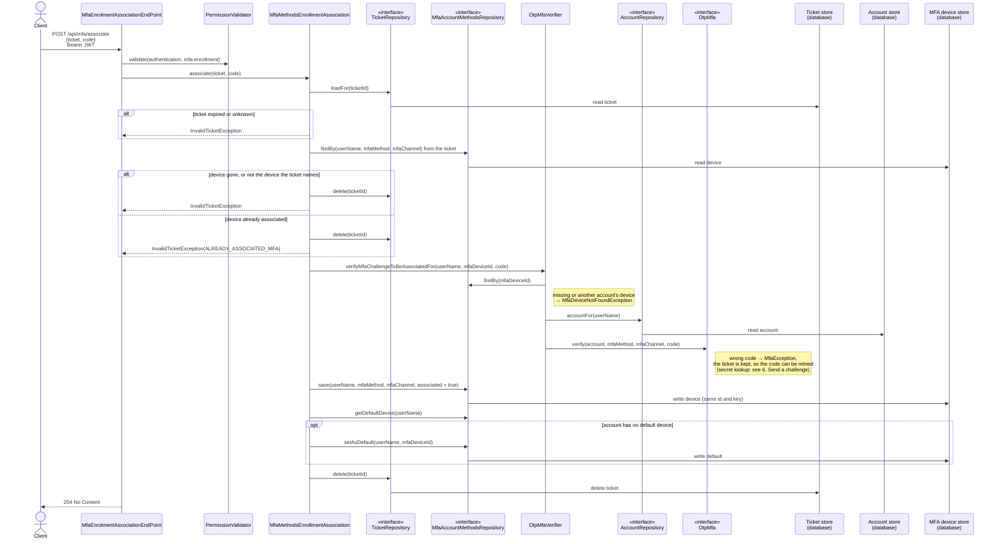
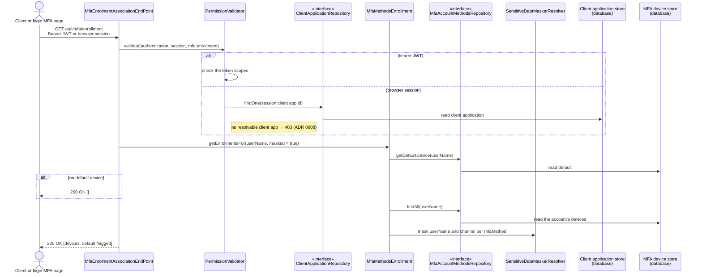
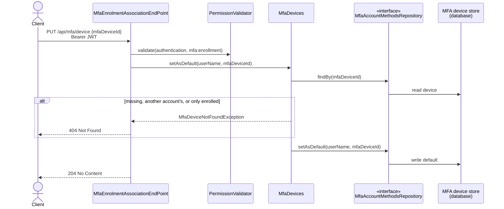
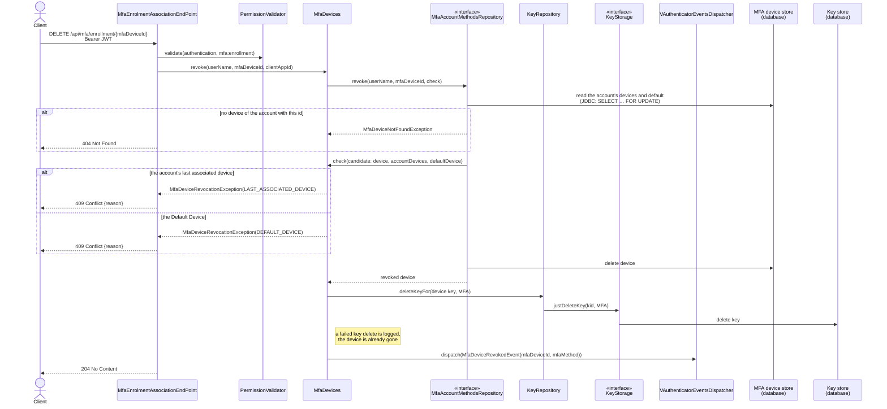
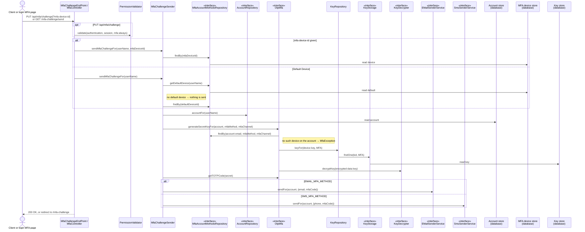
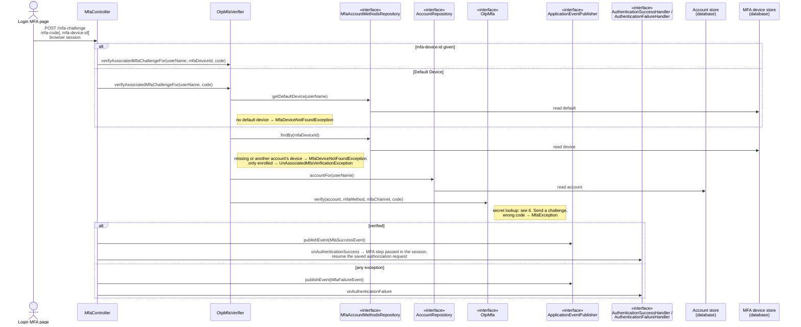

# MFA sequence diagrams

The MFA use cases from the HTTP entry point down to the stores. The endpoints are described in [mfa.md](mfa.md), the vocabulary (MFA Device, Enrolled, Associated, Default Device, Revoke) in [CONTEXT.md](../CONTEXT.md).

Every adapter appears only as the port it implements (`«interface»`): the JDBC and DynamoDB repositories, the KMS and plain-Java key components, and the email and SMS senders are interchangeable behind them (see [profiles.md](profiles.md)). Domain classes appear by name. Stores are marked `(database)`.

The diagrams are Mermaid, so GitHub renders them in place.

## 1. Enrol an MFA Device

`POST /api/mfa/enrollment`: registers a channel as an enrolled device, sends it a code and returns the ticket to associate it with.

## 2. Associate an MFA Device

`POST /api/mfa/associate`: confirms the code sent to an enrolled device and makes it associated. The email-verification link follows the same path without a code (self-association) and always sets the device as default.

## 3. List the MFA Devices

`GET /api/mfa/enrollment`: also called by the login MFA page through the browser session.

## 4. Set the Default Device

`PUT /api/mfa/device`.

## 5. Revoke an MFA Device

`DELETE /api/mfa/enrollment/{mfaDeviceId}`: the rules are in ADR 0009. The repository runs the domain's check between reading and deleting, so an adapter that can (JDBC) holds the account's devices locked for the whole step.

## 6. Send a challenge

`PUT /api/mfa/challenge` (API, optional `mfa-device-id`) and `GET /mfa-challenge/send` (login MFA page, Default Device). Enrolment (1) uses the same sender for the new device.

## 7. Verify the second factor at login

`POST /mfa-challenge`: the login MFA page submits the code, optionally with the device it was sent to. Verification fails closed when the device cannot be resolved (VA-SEC-19). Passing it makes MFA a passed step for the rest of the session, then resumes the authorization request that asked for it; the login workflow is checked again on every authorization request (ADR 0010).

